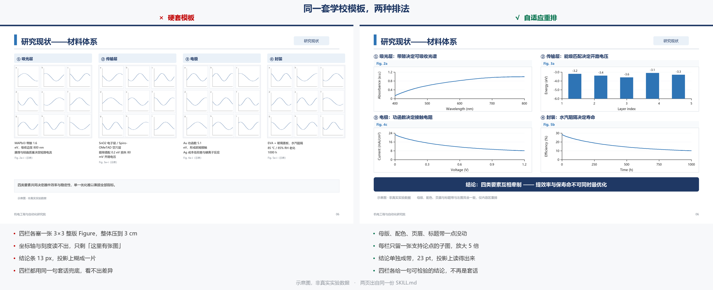

# research-ppt-adaptive

**做开题/答辩 PPT，套了模板还是不好看？因为"模板保真"和"布局保真"是两件事。**

这个技能保留学校模板的母版、配色、字体层级和页眉标识，但**逐页重新决定内容怎么排**——四栏装不下就改两行两列，六宫格塞不进就拆成上下两组，整版 Figure 看不清就只留关键子图。

不是"不套模板"，是**知道哪一层该保、哪一层该改**。




<sub>同一套学校模板 · 左边硬套，右边重排 · 母版、配色、页眉完全一致，只有内容区变了。[**看大图**](docs/compare-vertical.png) · 示意图，非真实实验数据</sub>

---

## 安装

### 方式一：下载 zip 上传（最稳，推荐）

1. 下载 [`dist/research-ppt-adaptive.zip`](dist/research-ppt-adaptive.zip)（40 KB）
2. WorkBuddy → 左侧「专家·技能·连接器」→ 技能 → **添加技能 → 上传技能**
3. 选择刚下载的 zip，自动完成配置

> zip 内顶层就是 `SKILL.md`，不需要解压改名。

### 方式二：对话里一句话装

```
帮我安装这个技能：https://github.com/runzeh01152001/research-ppt-adaptive
```

也可以用「技能管理 → 通过 URL 导入」，填上面的仓库地址。

> 国内直连 GitHub 偶尔会失败。拉不下来就退回方式一。

### 方式三：手动放目录

```bash
git clone https://github.com/runzeh01152001/research-ppt-adaptive.git

# 用户级（所有项目可用）
cp -r research-ppt-adaptive ~/.workbuddy/skills/

# 或项目级
cp -r research-ppt-adaptive <项目>/.workbuddy/skills/
```

### 运行脚本还需要两个库

```bash
pip install -r requirements.txt   # python-pptx, Pillow
```

技能本身不装库也能加载，但五个校验脚本要跑就得有这两个。

---

## 它解决什么问题

套模板时最常见的六种废页，这个技能把它们变成**可以阻断交付的检查项**，而不是"建议注意"：

| 症状 | 通常做法 | 这个技能的做法 |
|---|---|---|
| 整版多面板 Figure 被压成细条，坐标轴读不出 | 再缩小一点 | 判为停止条件，只保留关键子图或拆页 |
| 三栏并列被用来装因果链，读者找不到先后 | 加箭头 | 判定为功能不匹配，`redesign` 成流程 |
| 六宫格硬塞六个不同层级对象（三个填料 + 三个基体） | 六个都放 | 分类逻辑优先，改上下两组 |
| 为了填满第四个图槽，找一张"看起来相关"的图 | 先塞进去 | 缺证据就 `hold`，不许当装饰 |
| 内容页混进自己的实验结果，和文献图并排 | 没注意 | 证据类型强制登记，文献/本人结果分开 |
| 改完自己看着还行，投影上全糊 | 目测 | 全页 2 倍渲染 + 逐页四项记录 |

---

## 核心思路

### 优先级，冲突时上层覆盖下层

```
1. 科研真实性与用户约束      已完成不能写成计划，文献不能写成自己的结果
2. 论证关系与可读性          结论先成立，图要读得清
3. 模板视觉体系              母版、配色、字体层级、页眉标识
4. 网格对称与装饰            最不重要，可删可改
```

### 逐页五种决策

| 决策 | 什么时候用 |
|---|---|
| `reuse` | 结构、容量、证据比例都相符，直接沿用 |
| `adjust` | 论证结构相符，只调图位、栏宽、文字量、装饰 |
| `redesign` | 信息关系不符，在同一视觉体系内重排内容区 |
| `split` | 单页无法读清，**需明确授权**后拆页 |
| `hold` | 关键来源、结构许可或可行布局缺失，暂停该页 |

`reuse` 只在**参考页功能 = 内容功能**且语义适配通过时才允许。参考页是"分类矩阵"、你的内容是"因果流程"，标 `reuse` 会被关卡直接拦下。

### 页面功能要分到这个粒度

`cover` `agenda` `problem` `comparison` `classification` `process` `timeline` `system_diagram` `result` `plan` `closing`

只写"研究现状""研究内容"是不够的——同样叫"研究现状"，可能是分类、可能是比较、可能是演进。

### 硬套停止条件

出现任一情况必须改结构，不许继续缩：

- 关键图例 / 坐标不可读
- 必须裁掉证据才能填进图槽
- 并列布局被用来装因果流程
- 对称版式拆散了必要的对照关系
- 缺素材而遗留旧课题的图
- 持续缩字 / 压图 / 叠框

> 几何审计没有报错，**不能**推翻上面任何一条。

---

## 怎么用

```
① 定场景 / 模式 / 边界
        ↓
② 内容先行：每页先写 论点 → 证据 → 结论，再去找模板页
        ↓
③ 参考页功能映射：参考第 N 页到底是哪种关系
        ↓
④ 逐页适配决策 reuse / adjust / redesign / split / hold
        ↓
⑤ 代表页试制 → 单独渲染 → 检查 → 再批量铺开
        ↓
⑥ 素材核验与安全编辑
        ↓
⑦ 分层验收：机器审计 + 全页 2 倍渲染 + 逐页四项记录
```

### 五个校验脚本

| 脚本 | 查什么 |
|---|---|
| `audit_deck.py` | 越界、图片宽高比偏差、文本框 bbox 交集候选、低 DPI、内部关系、动画目标残留 |
| `review_deck.py` | 逐页四项：图片几何 / 文字遮挡 / 可读性 / 内容对应 |
| `research_plan.py` | 证据类型、文献引用、禁用来源与派生祖先 |
| `adaptation_gate.py` | 逐页决策、授权、代表页、最终阶段渲染路径 |
| `template_mapping.py` | 参考页—成品页功能映射与对照记录 |

全部是**只读检查器**：不生成、不渲染、不修改你的 PPT。

```bash
# 典型流程
python scripts/audit_deck.py template.pptx --write-baseline baseline.json
python scripts/adaptation_gate.py init --scenario proposal --output plan.json
python scripts/template_mapping.py init --output mapping.json
python scripts/adaptation_gate.py check plan.json --stage plan    # 计划关
python scripts/adaptation_gate.py check plan.json --stage pilot   # 代表页关
python scripts/audit_deck.py final.pptx --source template.pptx \
    --baseline baseline.json --report audit.json
python scripts/review_deck.py check final.pptx --checklist review.json
```

每个脚本都支持 `--help`。

---

## 为什么能信

- **144 项检查**，`unittest` 纯标准库，不依赖 pytest
- 覆盖四类场景：开题报告 / 毕业答辩 / 组会汇报 / 项目申报
- 边界写死，不吹能力（见下节）

```bash
cd tests
python test_adaptation_gate.py      # 24
python test_research_plan.py        # 18
python test_review_deck.py          # 14
python test_template_mapping.py     # 36
python test_audit_deck_revision.py  # 28 回归 + 24 新增
```

---

## 适合谁

| 适合 | 不适合 |
|---|---|
| 有学校/学院固定模板，必须保留视觉身份 | 一张白纸从零做 PPT → 用通用 PPT 技能 |
| 内容多、模板槽位明显不够用 | 内容刚好能填满模板 → 直接套就行 |
| 要在组会/开题/答辩上被导师追问逻辑 | 只要"看起来像模板"就交差 |
| 愿意花 10 分钟填记录换一次可靠的验收 | 希望全自动、一键出片 |

**它不是排版器，是"排版决策的检查清单 + 执行记录"。** 版式还是人在做，它负责不让你在六个具体的地方糊弄过去。

---

## 能力边界

明确**不做**：

- ❌ 不自动识别页面功能、不判断模板与成品的视觉对应 → 必须人工核实
- ❌ 不自动生成 PPT、不渲染、不做版式合成
- ❌ 不自动识别图源、不判断科学真伪
- ❌ 不能证明用户真的批准过、也不能证明检查者真的逐页看过
- ❌ 不会自动填 `pass`

三个容易误读的坑：

1. **文本框 bbox 相交 ≠ 字形真的碰撞。** 脚本报的是候选，要人看图确认。
2. **哈希未命中 ≠ 图源合规。** 裁剪、压缩、拼接后的局部仍继承原始来源。
3. **总览缩略图 ≠ 逐页验收。** 必须 2 倍逐页渲染并逐页填记录。

---

## 常见问题

**会不会自己改我的 PPT？**
不会。五个脚本只读文件、只写 JSON 记录。真正的编辑由 AI 按 `SKILL.md` 的流程做，你在编辑器里能看到每一步。

**必须装 Python 吗？**
只有想跑校验脚本时才需要（`python-pptx` + `Pillow`）。光让 AI 按流程改 PPT 不需要。

**和直接套模板差在哪？**
套模板决定的是"图放哪个框"，这个技能决定的是"这一页该不该用这个框"。差别在后者会**拒绝**某些框。

**能用于毕业答辩和组会吗？**
能。四类场景（开题/答辩/组会/项目申报）的论证规则不同，`references/research-scenarios.md` 里分开写了。

---

## 路线图

- [ ] **最终文件指纹绑定** —— 最终 PPT 的 SHA-256 同步写入四份记录，任何一份对不上就阻断交付
- [ ] **高风险动作完成检查** —— `actions` 未逐项标记已执行时不允许 final 通过
- [ ] **`redesign` 有效性判定** —— 仅换图换字不算 redesign，需检出实际布局变化
- [ ] 英文优先版本 + Claude Code marketplace 一键安装

## 相关技能

- `imitate-ppt` —— 严格模板仿写，用于"必须逐页原样复刻"的场合

两者互补，不是替代关系。**改动本技能不会影响 `imitate-ppt`。**

## License

MIT，见 [LICENSE](LICENSE)。

---

## English

**research-ppt-adaptive** is a skill for building academic decks (proposal defense, thesis defense, group meeting, grant reporting) on top of an institutional template — without blindly inheriting its layout.

Premise: *visual identity* (master, palette, type scale, section markers) should be preserved; *layout structure* (column counts, image slots, panel grids) should be re-decided per page based on what the content needs to argue.

Each page gets one of five decisions — `reuse`, `adjust`, `redesign`, `split`, `hold` — plus a function label (`classification`, `comparison`, `process`, `timeline`, `system_diagram`, `result`, …). A page may only be marked `reuse` when the reference page's function matches the new content's.

Five read-only Python checkers validate the plan, the deck geometry, and the per-page review records. They check record completeness and consistency — not taste. They do not generate slides, do not render, and do not judge scientific validity.

Install: download [`dist/research-ppt-adaptive.zip`](dist/research-ppt-adaptive.zip), or clone into `~/.workbuddy/skills/` (WorkBuddy) or your Claude skills directory.
